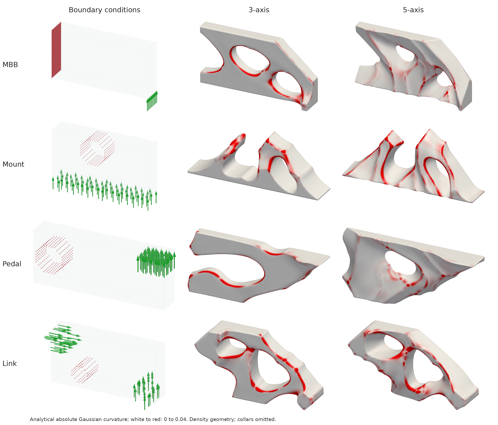
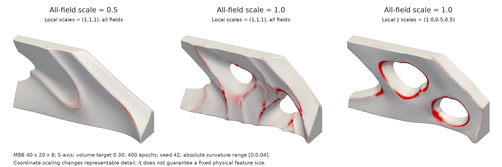

Written by a human:
The goal of this project is to solve something I have been dreaming about ever since I first saw a demonstration of topology optimization during undergraduate. It was Professor Krishnan Suresh who taught that course back in UW-Madison. To me, it was the “ChatGPT” well before LLMs for structure design. You can get a structure that is so optimized beyond even the most experienced designer. But to me, I see the issue is that for most aerospace parts that are manufactured (or finished) on a CNC, those organic parts do not lend themselves to efficient manufacturing. (If you want the most organic part for additive manufacturing, please check out my other publication [https://github.com/HongRayChen/MSNN](https://github.com/HongRayChen/MSNN)). Now the answer to efficient manufacturing is the prior work by Stein et al. With developable surfaces, you can have efficient manufacturing via flank milling. In fact, seeing how organic structure can look like if you make them developable for the first time really is beyond anything of my imagination. The challenge in doing so is that in order to integrate it into the optimization, you need to allow sharp seams and developable surfaces to co-exist. I think the work solves it elegantly by using three intersecting neural implicit fields. The neural implicit optimization provides the smooth and accurate analytical surface curvature and gradients, the three fields model the sharp seams.

As with most neural implicit topology optimization, it is a memory hog and if you have dramatically different boundary conditions, you will need to tune the network architecture, but I think with modern LLM agents it should be pretty much autonomous.

This paper is accepted to the journal Transaction on Graphics.

---

# BoxyTO

**Topology optimization for subtractive machining using trimmed neural fields.**

BoxyTO represents a structure with three intersecting neural implicit fields, combining structural stiffness, tool accessibility, developable surface patches, and sharp seams. An optional cutter-alignment objective supports 3-axis machining. This repository provides a PyTorch demo, explicit JSON examples, a bundled Top3d-style hexahedral finite-element solver, and PyVista rendering.

[Paper (PDF)](BoxyTO_arxiv-2.pdf) · [Quick start](#quick-start) · [Examples](#examples) · [Validation](docs/VALIDATION.md) · [Method](docs/METHOD.md)

## Demo gallery



**Four boundary conditions, two machining objectives.** Each row shows the boundary conditions, the 3-axis result, and the 5-axis result from a completed 400-epoch demo run. Red supports and green load arrows describe the setup. On the optimized surfaces, white-to-red indicates analytical absolute Gaussian curvature from 0 to 0.04. These figures show the optimized density geometry without cosmetic fixture collars. The MBB label follows the original notebook; its boundary condition is a cantilever-like clamp/load setup, rather than the standard symmetric half-MBB benchmark.



**Control the representation's feature scale.** The same boundary condition, 5-axis objective, volume target, seed, and 400-epoch budget are used throughout. Left: all-field scale 0.5. Center: all-field scale 1.0. Right: all-field scale 1.0 with local z scales of 1.0, 0.5, and 0.5 for the three fields. Coordinate scaling influences the representable detail; it does not guarantee a minimum physical feature size.

These are results from this demo implementation. Some thresholded designs lose load/fixture contact and show large increases in binary compliance. See the [validation report](docs/VALIDATION.md) for the numerical results and the [visualization guide](docs/VISUALIZATION.md) for rendering conventions.

## Paper

**Design for Machinability: Topology Optimization for Subtractive Machining Using Trimmed Neural Fields**

Hongrui Chen and Levent Burak Kara · Carnegie Mellon University

Accepted to **ACM Transactions on Graphics (TOG)**.

[View the paper](BoxyTO_arxiv-2.pdf) · [Download PDF](BoxyTO_arxiv-2.pdf?raw=1) (approximately 39 MB).

The included PDF is the supplied manuscript. Please cite the paper when using this method:

```bibtex
@article{chen_boxyto,
  author  = {Chen, Hongrui and Kara, Levent Burak},
  title   = {Design for Machinability: Topology Optimization for Subtractive Machining Using Trimmed Neural Fields},
  journal = {ACM Transactions on Graphics},
  note    = {Accepted for publication},
  url     = {https://github.com/HongRayChen/BoxyTO}
}
```

## Quick start

Use an existing **Python 3.10+** environment with NumPy >= 1.24, SciPy >= 1.11, PyTorch >= 2.4, and PyVista >= 0.44. GPU execution needs CUDA-enabled PyTorch. CuPy is optional for GPU finite-element solves and must match your CUDA installation. Rendering needs a working OpenGL/EGL or display setup. The comparison-plate script also uses Pillow; the notebook walkthrough needs Jupyter/IPython.

Clone the repository and run from its root; package installation is unnecessary:

```bash
git clone https://github.com/HongRayChen/BoxyTO.git
cd BoxyTO

# CPU smoke run: 80 epochs checks execution, not convergence.
python -m boxyto optimize examples/mbb_5axis.json \
  --output results/mbb_cpu --device cpu --fe-backend cpu --epochs 80
```

For the full 400-epoch example on a CUDA GPU:

```bash
# Neural optimization on GPU, finite-element solves on CPU.
python -m boxyto optimize examples/mbb_5axis.json \
  --output results/mbb_5axis --device cuda:0

# Optional CuPy finite-element backend; run after the first example completes.
python -m boxyto optimize examples/mbb_3axis.json \
  --output results/mbb_3axis --device cuda:0 --fe-backend cupy
```

Every run requires a **new or empty output directory**. Use the default 400 epochs for the supplied scientific examples. Open [BoxyTO_demo.ipynb](BoxyTO_demo.ipynb) for a compact notebook walkthrough; its default configuration uses CUDA and CuPy. Memory use and suitable network settings depend on the problem size and boundary conditions.

The [saved validation runs](results/validation) are included, so you can inspect figures, histories, meshes, and checkpoints without running optimization.

## Examples

| Configuration | Purpose |
| --- | --- |
| `examples/{mbb,mount,pedal,link}_{3axis,5axis}.json` | Four paper boundary conditions and both machining objectives |
| [random_single.json](examples/random_single.json) | Seeded random supports/forces with one access direction |
| [random_two_sided.json](examples/random_two_sided.json) | Seeded random supports/forces with z+ and z- accessibility |
| [no_design.json](examples/no_design.json) | Forced void sphere respected by FE, volume, accessibility, and rendering |
| [global_scale_coarse.json](examples/global_scale_coarse.json), [global_scale_fine.json](examples/global_scale_fine.json) | Uniform coordinate scaling for seamline feature control |
| [local_z_scale.json](examples/local_z_scale.json) | Independent z scaling of fields 2 and 3 |
| [custom.json](examples/custom.json) | Explicit support/load regions and fixed material |

Edit JSON configurations to define a problem. Supports and forces use integer physical node coordinates, and forces can be individual or distributed over a box. Fixed void/solid regions can be spheres or boxes. See the [example guide](examples/README.md) and [boundary-condition schema](docs/BOUNDARY_CONDITIONS.md).

## Outputs and rendering

Each optimization saves `config.json`, `boundary.json`, `history.csv`, `summary.json`, `density.npz`, and `model.pt`. The summary separates continuous and thresholded compliance and reports FE residuals, volume fractions, runtime, and fixed-region checks.

Default visual exports are `geometry.png`, `curvature.png`, `boundary.png`, and `mesh.vtp`. Re-render a bundled checkpoint at higher resolution without repeating optimization or FE:

```bash
python -m boxyto render results/validation/mbb_5axis \
  --device cuda:0 --samples 4 --size 1500
```

Use `--device cpu` if needed. Rendering updates the images and mesh in that run folder. Density arrays use `(y,x,z)` order, with row zero adjacent to physical y=max. Meshes, loads, supports, and custom regions use physical `(x,y,z)` coordinates. See the [visualization guide](docs/VISUALIZATION.md) for cameras, analytical curvature, and the separately labeled cosmetic assembly previews.

## Validation and scope

The included [validation report](docs/VALIDATION.md) documents 14 distinct 400-epoch configurations and numerical, gradient, coordinate, and rendering checks. The 34-test suite was also rerun successfully for this publication; [test output](docs/publication-tests.log) is included.

```bash
# CPU and offscreen rendering checks.
CUDA_VISIBLE_DEVICES="" python -m unittest discover -s tests -v

# Include CUDA/CuPy checks in a compatible environment.
BOXYTO_TEST_GPU=1 CUDA_VISIBLE_DEVICES=0 python -m unittest discover -s tests -v
```

See [validation commands](scripts/README.md) to repeat the full optimization matrix. An optional TensorFlow comparison in [check_notebook_parity.py](tests/check_notebook_parity.py) requires the original research notebook separately; TensorFlow is not a runtime dependency.

This is a documented PyTorch port of the original notebook mathematics. Centered FE cell sampling and consistent fixed-region handling address notebook inconsistencies; exact reproduction of the paper's numerical table is not claimed. GPU reductions and hardware differences can alter final topologies. See [method and provenance](docs/METHOD.md).

**Structural interpretation:** several supplied examples show large compliance increases after density thresholding, including loss of load/fixture contact. Check the saved continuous and binary results, prescribe physical fixed-solid fixture regions where needed, and re-evaluate the geometry. Cosmetic collars shown in optional assembly previews do not enter FE analysis. Sampled accessibility does not replace cutter/collet collision analysis or CAM verification.

## Repository guide

| Path | Contents |
| --- | --- |
| [boxyto/](boxyto) | Neural fields, optimization, boundary conditions, FE, and rendering |
| [examples/](examples) | JSON problem configurations |
| [BoxyTO_demo.ipynb](BoxyTO_demo.ipynb) | Notebook walkthrough |
| [docs/](docs) | Method, boundary conditions, visualization, and validation |
| [tests/](tests) | Numerical, gradient, configuration, and rendering checks |
| [scripts/](scripts) | Full validation and figure-composition utilities |
| [results/validation/](results/validation) | Completed demo runs, figures, meshes, checkpoints, and logs |
| [BoxyTO_arxiv-2.pdf](BoxyTO_arxiv-2.pdf) | Paper manuscript |

The FE formulation follows Liu and Tovar, *An efficient 3D topology optimization code written in Matlab*, Structural and Multidisciplinary Optimization (2014), and the [Top3d project](https://www.top3d.app/). Related work by the author: [MSNN](https://github.com/HongRayChen/MSNN).
